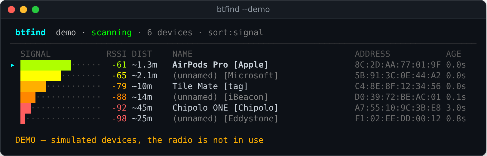
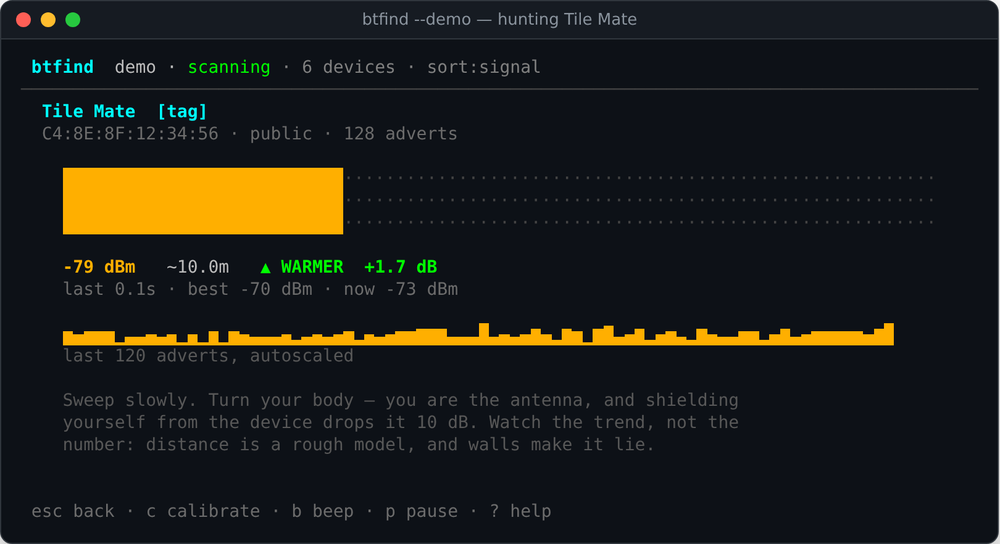

# btfind

A terminal UI for physically finding Bluetooth LE devices by signal strength —
a hotter/colder detector for the tag on your keys, the earbud under the sofa, or
whatever beacon is quietly advertising in the next room.



Select a device and press Enter to hunt it:



Both screenshots are from `./btfind --demo`, which simulates devices without a
radio.

## Build

No dependencies beyond a C++20 compiler — no ncurses, no libbluetooth, no
D-Bus. Just:

```sh
make
```

## Run

```sh
./btfind
```

That works even unprivileged **if something on the system is already scanning**
(see the observe-mode note below). For btfind to run a scan of its own — full
rate, active, continuous — it needs raw HCI socket access. Grant it to the
binary rather than running the whole thing as root:

```sh
make caps    # runs: sudo setcap 'cap_net_raw,cap_net_admin+eip' ./btfind
```

Two things about capabilities worth knowing, because both bite in practice:

- They are stored **on the binary file**, so every rebuild wipes them.
  Re-run `make caps` after `make`.
- Network filesystems (SMB, NFS) cannot store them — `setcap` fails with
  `Operation not supported`. If the repo lives on such a mount, copy the binary
  to a local disk and cap it there
  (`cp btfind ~/.local/bin/ && sudo setcap 'cap_net_raw,cap_net_admin+eip'
  ~/.local/bin/btfind`), or fall back to `sudo ./btfind`.

To try the interface without a Bluetooth adapter — in a container, over SSH to a
headless box, or just to see what it does:

```sh
./btfind --demo
```

## Keys

| Key | |
|---|---|
| `↑ ↓` / `j k` | move the selection |
| `⏎` | hunt the selected device |
| `/` | filter by name or address (`Esc` clears) |
| `s` | cycle sort: signal, name, recent, found |
| `f` | cycle the RSSI floor: all, −80, −65 |
| `n` | only devices that advertise a name |
| `p` | pause · `r` forget everything |
| `?` | help · `q` quit |

In hunt mode: `c` calibrates (see below), `C` clears that calibration, `b`
toggles a geiger-counter beep whose click rate rises as you close in, `Esc`
returns to the list.

## How to actually find something

Walk slowly and watch the **trend**, not the number. Turn your body as you go:
you are mostly water, you absorb 2.4 GHz well, and putting yourself between the
antenna and the device drops the reading by around 10 dB. That asymmetry is
often a better bearing than the absolute signal.

RSSI is genuinely noisy. Two consecutive advertisements from a device that has
not moved routinely differ by 10 dB, because the radio hops between three
advertising channels and every surface nearby reflects. So nothing in the UI
shows you a raw sample: the display is an exponential average, and the
WARMER/COLDER call comes from a fast average pulling away from a slow one.

### About the distance figure

It is a log-distance path-loss estimate:

```
d = 10 ^ ((tx_1m − rssi) / (10 · n))
```

which assumes free space and an isotropic antenna. Indoors, through a wall, or
with the device in someone's pocket, it can be wrong by a factor of several.
Treat it as an order of magnitude, and trust the trend instead.

You can sharpen it. Stand one metre from the device and press `c` — that pins
the current reading as the 1 m reference for that device specifically. iBeacon
and Eddystone transmitters advertise a calibrated figure and are used
automatically. Otherwise the default is −59 dBm, adjustable with `--txpower`.

The exponent `n` defaults to 2.0 (open air). Indoors, 3.0 to 4.0 is more
realistic; set it with `--path-loss`.

## Options

```
-i, --adapter N       use hciN (default 0)
    --demo            simulate devices instead of using the radio
    --passive         passive scan; does not solicit scan responses, so
                      fewer devices reveal a name
    --takeover        stop a scan another process is running and impose our
                      own parameters (see Notes)
    --interval MS     scan interval (default 100)
    --window MS       scan window (default 100 — equal means listen continuously)
    --txpower DBM     RSSI a device shows at 1 m (default -59)
    --path-loss N     path-loss exponent: 2.0 open air, 3-4 indoors
    --min-rssi DBM    hide anything weaker
    --stale S         dim devices unheard for this long (default 30)
    --forget S        drop devices unheard for this long (default 120)
    --log FILE        append every advertisement to FILE as CSV
    --no-color        plain output
    --selftest        run the built-in checks and exit
```

`--log` writes `time_ms,address,rssi,name` per advertisement, which is useful
for plotting a walk afterwards.

## What it does and doesn't cover

**BLE only.** It runs an LE scan and reads Advertising Reports, which give 10–50
RSSI samples per second per nearby device — that sample rate is what makes the
hunt meter responsive. Classic BR/EDR is not scanned: inquiry yields roughly one
RSSI sample every 1.3 seconds and only for devices in discoverable mode, which
is too coarse to walk with.

Devices only appear if they are advertising. A phone with the screen off, or
earbuds already connected to something, may be silent. Many modern devices also
rotate a random address every ~15 minutes, so they will reappear under a new
address; hunt by name where you can.

## Notes

- `--passive` avoids transmitting anything at all, at the cost of seeing fewer
  names (most devices put their name in a scan response, which only an active
  scan solicits).
- If something is already scanning — `bluetoothd`, or the kernel's own
  background LE scan — btfind **observes that scan** instead of fighting for the
  controller, and the status bar shows `(observing)`. This also works entirely
  unprivileged. The trade-off is that the reports arrive on that scan's terms:
  its duty cycle, its active/passive choice. If the observed scan is idle you
  will see nothing; either kick off a discovery (`bluetoothctl scan on`) or pass
  `--takeover` to stop the running scan and impose btfind's parameters —
  knowing that it breaks the other process's discovery, and that a
  kernel-managed scan usually reasserts itself anyway. `--takeover` requires
  the capabilities above and refuses to run without them rather than silently
  observing.
- Run `./btfind --selftest` to exercise the advert parser, the smoothing, the
  distance model, and the layout maths. It needs no adapter.

## Testing status

Verified end-to-end on real hardware: extended scanning (modern controllers are
driven with the LE extended command set, which the spec forbids mixing with the
legacy one — btfind picks the set from the controller's feature bits),
`--takeover` of a scan held by `bluetoothd`/the kernel, unprivileged observe
mode, and the capability error ladder. The self-test (166 checks, no adapter
needed) covers both advertising-report formats with byte-level fixtures, the AD
parser against malformed payloads, the smoothing, and the layout maths.

The residual unknown is controller diversity — other chipsets may have their
own quirks. If you hit one, the error message names the failing command and
status code, and `sudo btmon` alongside shows the full HCI conversation.
